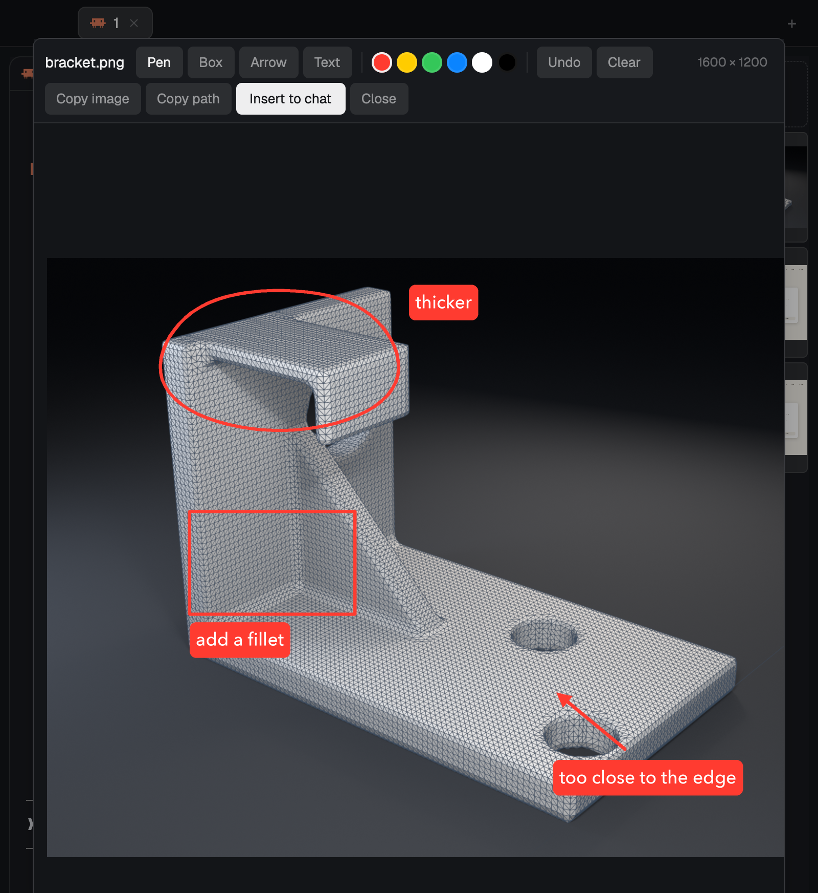

# Scribble

A person drops an image into a narrow tray at the right of the Herdr window. A large dialog opens with the image. They draw on it with a pen, a box, an arrow or a text label, then press Insert to chat: the dialog closes and the marked image is pasted into the terminal of their agent. The agent sees the marks.

**What you see:**

- **The tray**, a column docked at the right, 200 px wide (`mod.json`: `{ "place": "right", "size": 200, "title": "Scribble" }`), `theme().background`, 8 px padding, 8 px gaps.
  - On top, the drop box: 96 px high, 8 px corners, a 1 px dashed border in `theme().input`, two centered lines: "Drop an image" (13 px, `muted`) and "or click, then Cmd+V" (11 px, `dim`). With the keyboard on the tray the border turns `accent`, the fill `surface`, and the lines read "Press Cmd+V to paste" / "or drop a file here".
  - Under it, the items of the shown space, newest first, scrolling: rows 76 px high with a 64 px square thumbnail (4 px corners), the file name (12 px, `muted`, truncated) and a 20 px "×".
  - When the column is under 120 px wide: a dashed "+" box as wide as the column, then square thumbnails only.
- **The editor**, a modal dialog 92% of the window wide and high.
  - A toolbar: the file name; Pen, Box, Arrow, Text (28 px high buttons, the chosen one in `selected`); six 18 px color dots (`#ff3b30`, `#ffcc00`, `#34c759`, `#0a84ff`, `#ffffff`, `#000000`, the chosen one ringed in `foreground`); Undo, Clear; at the right the pixel size, Copy image, Copy path, Insert to chat (`solid` / `solid_foreground`, semibold) and Close.
  - The stage, `theme().canvas`: the image fitted with 12 px of room, never above 100%, a crosshair pointer over it.
  - With the Text tool, after a click on the image: a 42 px row under the toolbar with an input ("Type the label, then press Enter"), Add and Cancel, and an 8 px dot on the image where the label will go.
- **Marks**: lines 0.4% of the image's long side wide; an arrow has a filled head 4.5 line widths long; a label is text 2.2% of the long side high on a rounded fill of the chosen color (black text on white and yellow, white on the rest).

**How it behaves:**

- Agent statuses are not shown; the mod does not follow agents.
- Drop image files on the tray, or click the drop box and press Cmd+V (the clipboard's image, or copied files). Each new image goes to the top of the shown space's list and its editor opens. A click on a row opens it again, with the marks it had. "×" (in the narrow form: a right click) removes it and forgets its marks. Lists are per space, hold 30 items, and survive a restart.
- In the editor: press and drag draws with the chosen tool; Pen follows the pointer, Box and Arrow stretch from the press. Text: click a spot, type, Enter. Cmd+Z undoes the last mark, Cmd+C copies the marked image, Cmd+Enter inserts, Esc closes.
- Insert to chat: the marked image is saved as a PNG and put on the clipboard, the dialog closes, the terminal that had the focus when the editor opened gets the focus back and `terminal.paste` runs, so the agent's program receives the image as a normal paste. A toast names the saved file.
- Copy image puts the marked PNG on the clipboard; Copy path the saved file's path.
- Saved files: `<folder of the active space>/.scribble/<name>-marked-<time>.png` (30 kept), with `.scribble/` added to the repository's `.git/info/exclude`; when the space has no local folder, `~/.config/herdr-app/data/scribble/out/`.
- `python3 mods/scribble/view.py <file>...` from a terminal: images go to the tray of that terminal's space (shown now if it is the shown space, else a toast); a `.md` / `.txt` file opens as a tab whose only pane is this mod, a markdown reader with Copy path, Open outside and Reveal that re-reads the file every 3 s.

**Built from:**

- One mod folder, `mods/scribble/`: `main.js`, `mod.json`, `view.py`, `image.svg`. No layout of its own.
- `main.js` exports one `View` with four roles chosen by `props()`:
  - none: the tray. `{ tab }` instead names another inbox than `dock`.
  - `{ editor: true, item, terminal, folder }`: the dialog, opened by the tray with `openOverlay({ mod: "scribble", kind: "dialog", modal: true, width: 0.92, height: 0.92, props })`.
  - `{ page: "<path>" }`: the markdown reader (`TextView.markdown`), opened with `tab.new { mod, props }`.
  - `{ button: true, icon? }`: an optional "Images" toggle for a layout whose side panel is a stack `panel-body` inside `panel` with this mod as the child `view`; it handles the key command `scribble.toggle` (`nextCommand()`), keeps a width for each side with `layout.resize`, and adds `"view"` to shared `workspace.panels`.
- Drawing: marks are kept as fractions (0..1) of the image, `{ type: "pen", pts } | { type: "box" | "arrow", a, b } | { type: "text", at, text }` plus `color`. On screen each is a `window.paint_path(PathBuilder…)` layer (a label: a `div`) laid over `image(rel)`; pointer positions come from `on_mouse_down` / `on_mouse_move` `local_position` on the image element, and `on_mouse_up` on the root ends a stroke.
- `herdr` functions: `exec`, `props`, `focused`, `panes`, `spaces`, `run` (`pane.focus`, `terminal.paste`, `tab.new`, `layout.*`), `theme`, `notify`, `appHome`, `readTextFile`, `watchFolder`, `shared` / `setShared` (`scribble.marks`: marks by file path), `openOverlay` / `closeOverlay`, `layout`, `nextCommand`; `localStorage` (`items`: lists by space id); `fs/promises` (`mkdir`, `writeFile` for the inbox).
- `view.py` (Python 3 with Pillow), run through `exec("python3", …)`:
  - `add <paths>`: links or converts each image into `data/scribble/src/` (an `image()` path must be inside the app's home) and prints `{ kind, path, name, w, h, rel }`.
  - `paste`: the clipboard's image (`ImageGrab.grabclipboard`) as an item.
  - `flatten <json>`: draws the marks on the full-size image with Pillow, saves the PNG, then `osascript` (`«class PNGf»`) for the image or `pbcopy` for the path.
  - anything else: `show`; writes `data/scribble/inbox/dock.json` `{ id, files, space }` and waits for the tray's `dock.ack` with the same id; the tray watches the folder with `watchFolder`.
- Other programs: `/usr/bin/open`, `/usr/bin/pbcopy`, `/usr/bin/osascript`, `git`, `herdr-app do`.

**Watch out:**

- Herdr may not dock the tray by itself from `mod.json`; then add a block `{ "id": "scribble", "type": "block", "size": { "px": 110 }, "content": { "mod": "scribble" } }` to the row of the person's own layout that holds the panes.
- macOS only as built (clipboard and open commands). `python3` on the PATH must have Pillow; without it every add fails with a toast.
- The paste after Insert runs from a detached `sh -c 'sleep 0.15; herdr-app do pane.focus …; sleep 0.15; herdr-app do terminal.paste'`, because the dialog's own tasks stop when it closes.
- The target terminal is read when the editor opens (`focused().terminal`, else the shown tab's first agent pane). With no terminal, Insert shows an error toast and does nothing.
- The tray's items live in `localStorage`, the marks in shared state: removing an item deletes its marks, closing the editor does not.
- The flattened label uses Helvetica; on screen it is the app's font, so the label's width differs by a few pixels.
- There is no zoom or pan in the editor, no eraser (Undo and Clear only), and marks cannot be moved.
- Herdr does not see saves through a symlinked mod folder; copy the folder, or `touch -h` the link after an edit.
- `on_drop` must sit on plain layout elements (the root and the drop box).

**Done when:**

- `herdr-app check ~/.config/herdr-app/mods/scribble` passes.
- `python3 mods/scribble/view.py <png>` prints `"pane": "dock"` and the editor opens with that image.
- A drag with Box leaves a rectangle; Cmd+Z removes it.
- Copy path puts a path on the clipboard and that PNG shows the marks at the image's full size.
- Insert to chat closes the dialog and the focused terminal's program receives the image.
- Another space shows its own, different list.
